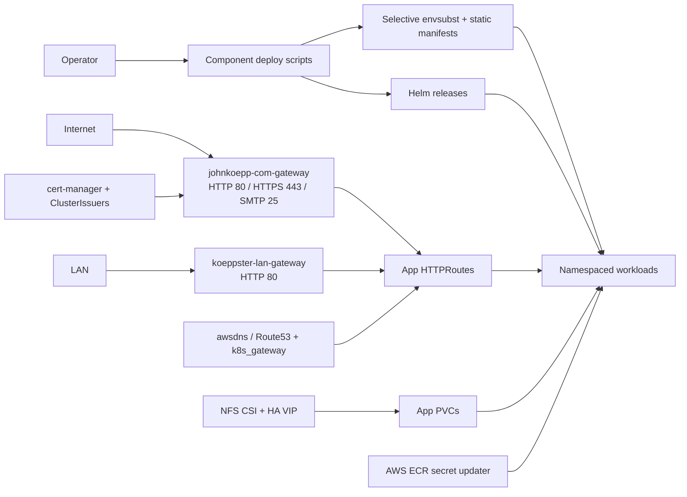

# Kubernetes sandbox architecture

This repository operates a four-node MicroK8s cluster (v1.33.13 in the [2026-11-07 live inventory](./component_inventory.md)). Shell scripts and component-local `.env` files drive selective manifest rendering and apply; Helm is used for shared controllers and Grafana/Loki. The `infrastruture/` and `keyclock/` spellings are the existing repository paths.

The [dependency guide](./dependencies.md) lists tools needed on the operator host and inside images. The [component inventory](./component_inventory.md) is the observed-state baseline for version and update impact assessments. This page describes the operating model and where currently running components fit.

## Deployment and traffic flow

`infrastruture/create-infrastructure.sh` enables MicroK8s addons, installs Envoy Gateway and the NFS CSI driver, configures MetalLB, cert-manager, DNS automation, AWS credential propagation, and creates the shared Gateway objects. App scripts create or label their namespaces and apply Secrets, storage, workloads, Services, and routes. `grafana+loki/scripts/deploy.sh` also installs the Grafana and Loki Helm charts. The cluster's `ingress` addon is disabled; routing is through Gateway API.

The public Gateway uses a wildcard TLS certificate issued by cert-manager. Public apps commonly have an HTTPS route and an HTTP redirect route. The redirect carries `koeppster.net/aws_common_name` and `koeppster.net/aws_status` labels for the Route53 updater. The LAN Gateway serves `*.k8s.koeppster.lan` routes through the `exdns` k8s-gateway DNS release. Keycloak and ntfy set forwarded headers at their routes. The public Gateway has an SMTP listener, but no TCPRoute is installed at this snapshot.

## Current application paths

| Area | Active controllers and dependency | Endpoint / owner |
| --- | --- | --- |
| `n8n` | n8n and Box MCP Deployments; active PostgreSQL 17 StatefulSet; NFS PVCs. A PostgreSQL 14 StatefulSet is retained at zero replicas after migration. | `orchestration.johnkoepp.com`; `n8n/scripts/deploy-n8n.sh` |
| `keycloak` | Keycloak Deployment and PostgreSQL 18 StatefulSet, both with NFS storage. | `idp.johnkoepp.com`; `keyclock/scripts/deploy.sh` |
| `grafana` | Grafana Helm Deployment, Loki Helm StatefulSet and Promtail DaemonSet, Box event collector Deployment. | `grafana.johnkoepp.com`, `grafana.k8s.koeppster.lan`, `loki.k8s.koeppster.lan`; `grafana+loki/scripts/deploy.sh` |
| `box` | Redaction Deployment and external `localapp` proxy Service/route. | `boxredact.johnkoepp.com`, `localapp.johnkoepp.com`; `box/scripts/deploy-redact.sh` and a separate proxy manifest |
| `meshcentral` | MeshCentral Deployment with file-based configuration Secret and NFS PVC. | `mesh.johnkoepp.com`; `meshcentral/scripts/deploy.sh` |
| `ntfy` | ntfy StatefulSet with cache/users NFS PVCs. | `ntfy.johnkoepp.com`; `ntfy/scripts/deploy.sh` |
| `default` | Running httpbin and observer example Deployments; Box webhook proxy route and Service. | Public/LAN example endpoints; `default/` and `test/` manifests |
| `afrba` | Two ECR-backed demo Deployments. | `rrdemo.johnkoepp.com`, `rrembed.johnkoepp.com`; maintained outside this repository |

Shared infrastructure also runs cert-manager, Envoy Gateway with one proxy Deployment per Gateway, AWS DNS and ECR automation, k8s-gateway, NFS CSI, MetalLB, CoreDNS, metrics-server, registry, Calico, hostpath provisioner, and KWasm. See the inventory for every controller, image, chart and observed version.

The `boxmcp` namespace has a Service and routes but no workload controller in the observed cluster. Jenkins, Box portal, Box quarantine, and Postfix have repository manifests but no deployed workload controller. The `postfix` namespace exists; no Postfix TCPRoute exists. Do not assume a repository directory implies a running app.

## Persistence and maintenance

The NFS CSI classes `kube-nfs`, `kube-postgres`, and `kube-grafana` currently provision from the NFS HA virtual IP `192.168.1.240`, using separate exports. The [NFS HA documentation](../nfs-ha/README.md) records the completed consumer cutover and current handoff procedure. Existing PVs can retain their creation-time server and export paths even when the StorageClass points at the VIP, so inspect PVs as well as StorageClasses during a storage change. The MicroK8s registry uses `microk8s-hostpath`, outside the NFS maintenance helper's scope.

Use `./bin/shutdown-nfs-workloads.sh --dry-run` to review the current target set before NFS maintenance. The restore helper's `--dry-run` requires the replica state file written by a real shutdown (or a matching file passed with `--state-file`); run it after that file exists. The helpers inspect live pod templates for PVC mounts and cover Deployments and StatefulSets only. Account separately for Jobs, DaemonSets, unmanaged Pods, and external NFS clients. The [maintenance handoff](../nfs-ha/maintenance-handoff.md) describes stopping writers before moving the NFS primary.

## Manifest rendering and live-state checks

Deploy scripts run `envsubst` only for deploy-time placeholders, especially Secrets, PVCs, and selected routes. Postgres init ConfigMaps in `n8n/` and `keyclock/` contain shell variables that must survive until container runtime. Some apps create file-based Secrets with `microk8s kubectl create secret generic --from-file`.

Review the component's deploy/check scripts and live `microk8s kubectl` state before an update. Known differences that matter here:

- `n8n/scripts/deploy-n8n.sh` applies the PostgreSQL 17 manifest; the old PostgreSQL 14 StatefulSet and its PVC remain as migration rollback artifacts.
- `box/scripts/deploy-quarantine.sh` creates its Secret and ConfigMap in `box-enterprise-quarantine`, while its manifests target `box`. Resolve this before deploying quarantine.
- `default/box-webhookd-route.yaml` uses hyphenated DNS label keys rather than the underscore keys the Route53 updater expects.
- `grafana+loki/values/grafana-values.yaml` includes an inline admin password; treat that values file as sensitive.

## C4 source diagrams

The diagrams in [c4/](./c4/) show deployed paths for [infrastructure](./c4/infrastructure.puml), [n8n](./c4/n8n.puml), [Keycloak](./c4/keycloak.puml), [Grafana/Loki](./c4/grafana.puml), [Box](./c4/box.puml), [MeshCentral](./c4/meshcentral.puml), [ntfy](./c4/ntfy.puml), and [default examples](./c4/default.puml). The [Jenkins diagram](./c4/jenkins.puml) documents a repository-defined stack that is not currently deployed.
